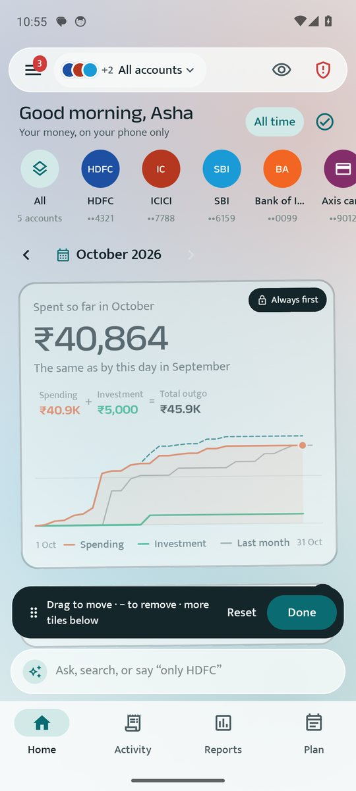
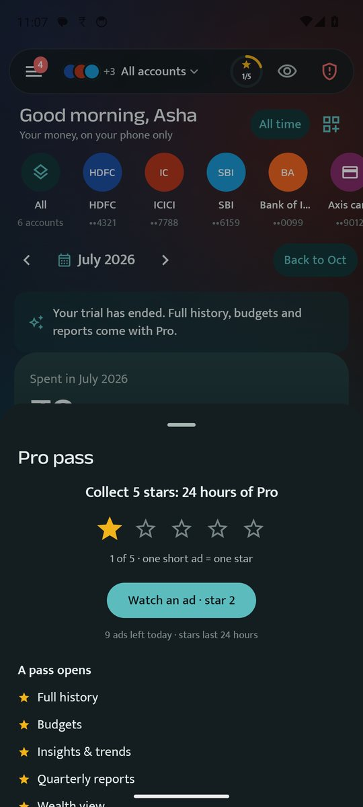

# FinInsight AI

**Your money, understood — privately, on your own phone.**

<b><a href="https://github.com/jangidsushil/FinInsight-app/releases/latest/download/FinInsight.apk">⬇️ Download for Android</a></b> · <a href="https://jangidsushil.github.io/FinInsight-app/">Website</a> · free · Android 8.0+

FinInsight reads the bank, card and UPI SMS already on your phone and turns them into clear books: what you spent, what came in, what's due, what you own, and which messages are scams. No bank login, no account, no upload.

## ⬇️ Download

**[Download FinInsight (latest)](https://github.com/jangidsushil/FinInsight-app/releases/latest/download/FinInsight.apk)**

This link always gives you the newest version. Share it freely.

Need Android 8.0 or newer. See all versions on the [Releases page](https://github.com/jangidsushil/FinInsight-app/releases).

### How to install

1. Tap the download link above in your phone's browser (Chrome works well).
2. When the download finishes, tap **Open** (or find `FinInsight.apk` in **Files › Downloads**).
3. If Android asks, allow **"Install unknown apps"** for your browser or Files app, then go back.
4. Tap **Install**. If you see *"This type of file can harm your device"*, tap **Download anyway** / **Install anyway** — this warning appears for every app installed outside the Play Store.
5. Open FinInsight and follow the short set-up.

**Updating:** download from the same link and tap **Update**. Your books, settings and Pro stay as they are.

## Screens

## What it does

- **Every bank message, read for what it means** — spending, income, investments, card bills, refunds and transfers between your own accounts, without double counting.
- **One account, a few, or all** — look at HDFC alone, HDFC + SBI together, or everything.
- **Any month, any year** — move back through your history; monthly, quarterly, yearly and tax-year reports with charts, PDF and Excel export.
- **Scam Shield** — warns about fraud SMS: fake KYC, electricity cut-off, e-challan, reward points, APK links.
- **Dues and bills** — payment requests, card bills and premiums before they're due.
- **Budgets, savings goals, insights and a money score** — with the transactions behind every number.
- **Ask in plain words** — "food last month", "only HDFC", "add 250 chai cash".
- **Cash entries, bank statement check, home screen widget, app lock (PIN / fingerprint), themes.**

## Your data stays on your phone

This is the core promise of FinInsight:

- **Your messages and books never leave your phone.** All reading and calculating happens on the phone. FinInsight has no server, no sign-up and no account.
- **Only money messages are kept.** Personal chats and OTPs are skipped. What is kept is stored **encrypted** (SQLCipher) inside the app.
- **No cloud backup by Android.** Backups happen only when *you* make one, as an encrypted file protected by *your* password, saved where *you* choose.
- **Ads never see your data.** The free version shows non-personalised ads from Unity Ads. The ad library asks for an ad like any website would; it gets **no advertising ID** (that permission is removed from the app) and nothing from your messages or books. Pro has no ads.
- **No contacts, location or advertising-ID permissions.** The standard edition doesn't even ask for SMS permission (see below).
- **Reporting a problem is your choice** — it opens your own email app with what you wrote; you see it before you press Send.

## Two editions

| | Standard (`FinInsight.apk`) | Automatic mode (`FinInsight-automatic-mode.apk`) |
|---|---|---|
| SMS permission | **None** — installs without Play Protect warnings | Reads SMS on the phone |
| How messages come in | An SMS backup file ("SMS Backup & Restore" app), or share a message to FinInsight | Automatically, the moment an alert arrives |
| Start with | ✅ This one | Only from inside the app: ☰ › Automatic mode |

Google Play Protect blocks apps that read SMS when they're installed outside the Play Store — it goes by the permission, not by what the app does. That's why you start with the standard edition and switch to automatic mode from inside the app, which walks you through it step by step.

## Free, trial, and Pro

- **Free, always:** the money ledger, this month and last month, Scam Shield, cash entries, dues and alerts, app lock.
- **7-day trial:** everything else, free for the first week.
- **After that:** watch one short ad to open one thing (an older month, a report, an export) — or collect **5 ★ (5 short ads) for a 24-hour Pro pass** with everything open.

## Common problems and fixes

**"App not installed" / "Package conflicts with an existing package"**
You have a copy signed differently (for example an old test build). Uninstall the old FinInsight first, then install again. Make a backup first if you want to keep your books: ☰ › Settings › Backup.

**"App not installed as package appears to be invalid"**
The download was cut short. Delete `FinInsight.apk` from Downloads and download it again on a stable connection.

**"Blocked by Play Protect" or "Harmful app blocked"**
You're installing the automatic-mode file directly. Install the standard `FinInsight.apk` first, then switch to automatic mode from inside the app (☰ › Automatic mode) — it explains how to pause Play Protect for that one install and reminds you to turn it back on.

**"Install unknown apps" setting keeps coming back**
Android asks once per app that installs files (Chrome, Files, WhatsApp…). Allow it for the app you're installing from.

**Nothing shows after set-up (standard edition)**
The standard edition can't read SMS by itself. Make a backup with "SMS Backup & Restore" (keep only Messages switched on) and choose that file in FinInsight, or share a bank message to FinInsight from your SMS app.

**A transaction is missing or wrong**
Some banks send unusual formats. Open the transaction (or ☰ › To confirm) and correct it once — FinInsight remembers for next time. To check an account fully, import its bank statement (☰ › Bank statements).

**The same account shows twice**
Banks sometimes mask numbers differently. Open one of them in ☰ › Accounts & cards and choose **Same as another account**.

**Amounts visible to people near you**
Tap the 👁 eye at the top to hide all amounts.

**No ad appears when I tap "Watch an ad"**
Ads sometimes run out for a moment, especially on slow connections. Try again in a minute; you can watch up to 10 a day.

**Notifications don't arrive**
Allow notifications for FinInsight in Android settings, and turn off battery optimisation for it (Settings › Apps › FinInsight › Battery › Unrestricted).

## Contact

Found a problem? In the app: **☰ › Report a problem** (mark the problem on screen and send it), or email **fininsight@yahoo.com**.

---
Made in India. Free with non-personalised ads; Pro removes them.
