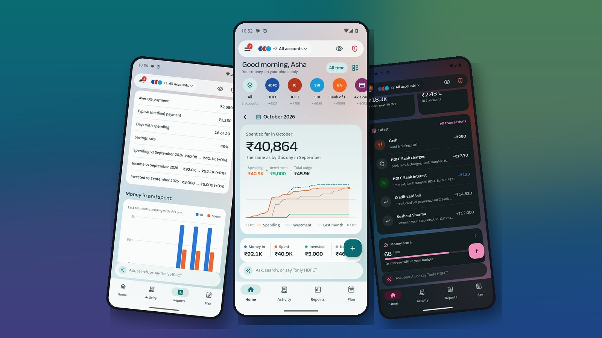
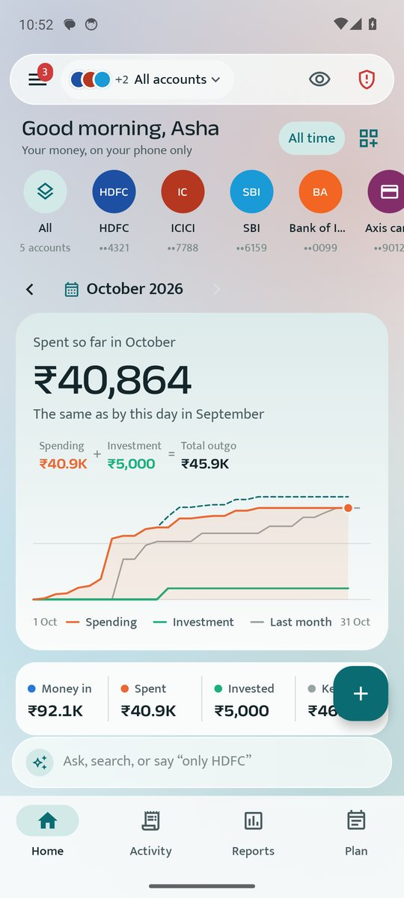
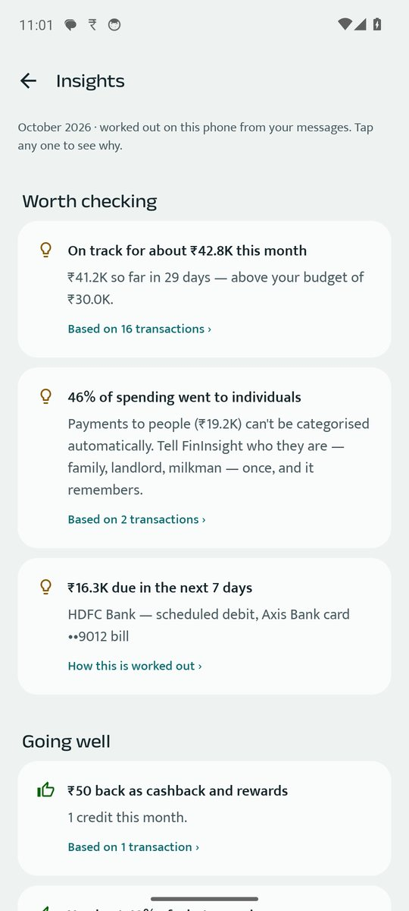
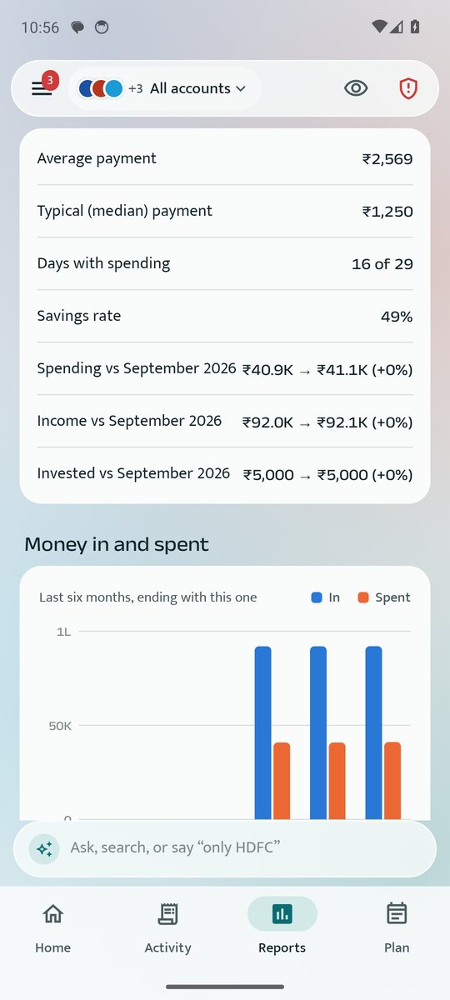
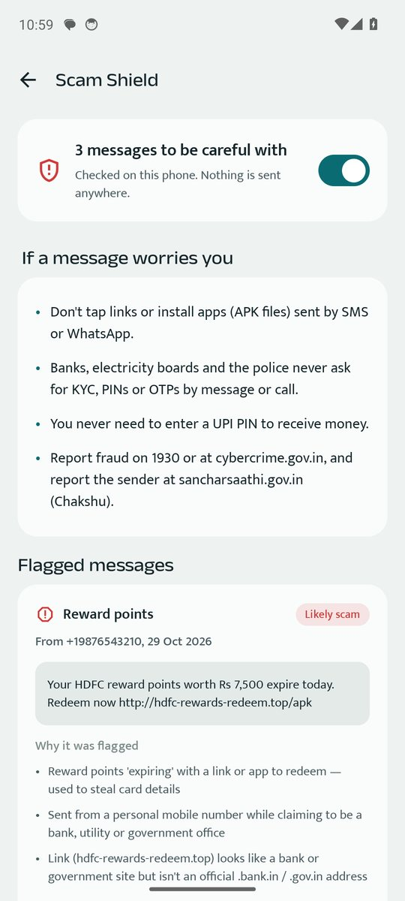
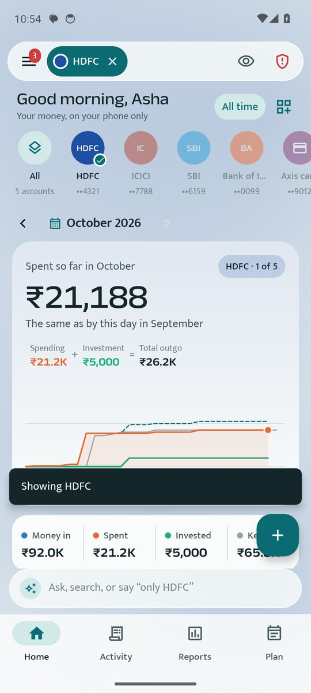
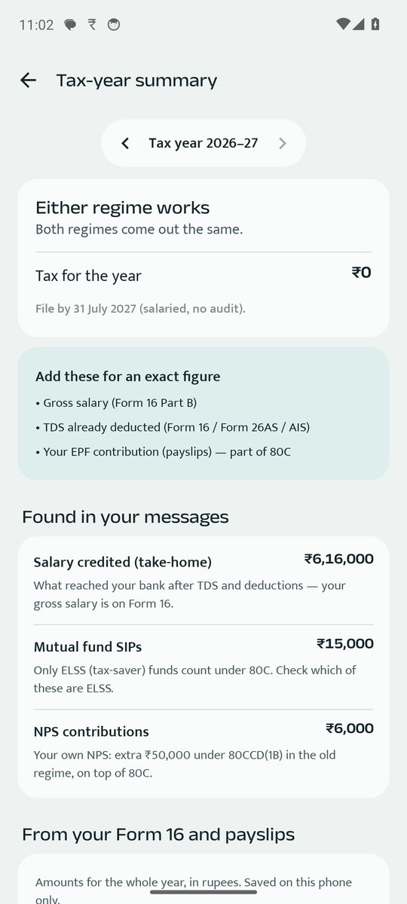
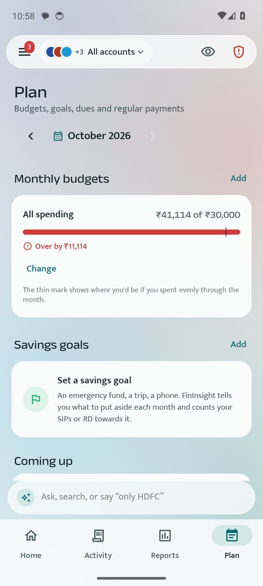
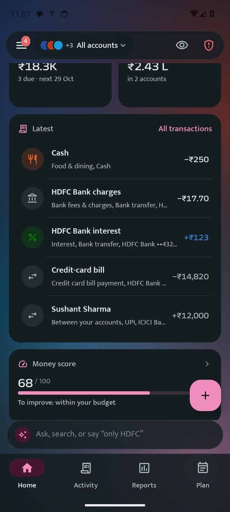

# FinInsight AI

**AI insights on your money — worked out on your phone.**

FinInsight AI turns the bank, card and UPI messages already on your phone into an automatic expense tracker, clear reports, budgets, a tax-year summary and scam alerts. Everything happens on the phone: no bank login, no account, and your data is never uploaded.

<b><a href="https://jangidsushil.github.io/FinInsight-app/download.html">⬇️ Download for Android</a></b> ·
<a href="https://jangidsushil.github.io/FinInsight-app/">Website</a> ·
free · Android 8.0+

> **Before you download:** FinInsight reads bank SMS, so Android asks you to pause Google Play Protect for the install and to allow your browser to install apps. The [download page](https://jangidsushil.github.io/FinInsight-app/download.html) shows the exact steps for Samsung, Xiaomi/Redmi/POCO, Vivo/iQOO, Oppo/Realme/OnePlus, Motorola, Pixel and others.

## Your data never leaves your phone

- **Everything happens on the phone.** Reading messages, categorising, forecasting and answering questions — no server, no sign-up, no upload.
- **No advertising ID shared.** The advertising-ID and ad-tracking permissions are removed from the app.
- **Encrypted storage.** Only money messages are kept, encrypted inside the app. Personal chats and OTPs are skipped.
- **No cloud backup.** Android's automatic cloud backup is off. Backups exist only when you make one, encrypted with your own password.
- **Minimal permissions.** SMS, notifications and fingerprint — no contacts, location, microphone or camera.

## AI Insights

- **Spending pace and month-end forecast** — "On track for ₹46.7K this month — above your ₹30K budget."
- **Money score out of 100** — every point explained, and the one thing to improve.
- **Subscriptions and regular payments found** — rent, SIPs, EMIs and streaming detected from patterns.
- **Salary, refunds and self-transfers recognised** — so totals show what you really spent.
- **Ask in plain words** — "How much did I spend on food last month?"
- **Tax-year summary** — salary, interest and 80C/80D items, with the old and new regimes compared.
- **Every number shows its evidence** — tap to see the exact transactions behind it.

## Screens

## Features

**Automatic money tracking** — bank, card, UPI and wallet SMS read on the phone; no double counting of transfers between your own accounts or card-bill payments; refunds matched to purchases; cash spends in two taps; corrections remembered.

**All your accounts, your way** — one account, a few, or all; balances, card limits and bills; any month or year; bank statement check (PDF, even password-protected, or CSV).

**Reports** — month, quarter, year, financial year, year-to-date or custom dates; month-on-month and year-on-year comparisons; categories, payees and day-by-day calendar; PDF and Excel export; shareable report cards.

**Plan ahead** — budgets with alerts; card bills, EMIs, premiums and payment requests before they're due; savings goals that count SIPs and RDs; wealth view.

**Safety** — Scam Shield for fraud SMS (fake KYC, electricity cut-off, e-challan, reward points, APK links); PIN or fingerprint lock; hide amounts with one tap; encrypted backup.

**Built around you** — Ask bar ("only HDFC", "last month", "add 250 chai cash"); customisable Home tiles; your own categories, friends & family, groups and trips; light and dark themes, colours, home-screen widget.

## Install

1. **Pause Play Protect** — Play Store › profile picture › Play Protect › ⚙ › turn off *Scan apps with Play Protect*.
2. **Allow your browser to install apps** — *Install unknown apps* (older phones: *Unknown sources*) for Chrome. Samsung One UI 6+: also turn off *Auto Blocker*.
3. **Download** [FinInsight.apk](https://jangidsushil.github.io/FinInsight-app/FinInsight.apk), install, open it, allow SMS — then **switch Play Protect back on**.

Phone-by-phone steps: **[jangidsushil.github.io/FinInsight-app/download.html](https://jangidsushil.github.io/FinInsight-app/download.html)**

**Updating:** download from the same link and tap **Update** — your books and settings stay.

## Common problems

- **"App not installed" / "conflicts with an existing package"** — an older copy is signed differently. Back up (Settings › Backup), uninstall it, install again and restore.
- **"Package appears to be invalid"** — the download was cut short; download again.
- **"Blocked by Play Protect"** — Play Protect wasn't paused; see step 1.
- **"Restricted setting" when allowing SMS** (Android 13+) — Settings › Apps › FinInsight › ⋮ › *Allow restricted settings*, then allow SMS again.
- **A transaction is wrong or missing** — open it and correct it once; FinInsight remembers. Import a bank statement to fill gaps.
- **The same account shows twice** — Accounts & cards › open one › *Same as another account*.

## Contact

In the app: **☰ › Report a problem** — or email **fininsight@yahoo.com**.

---
Made in India · Your data stays on your phone.
